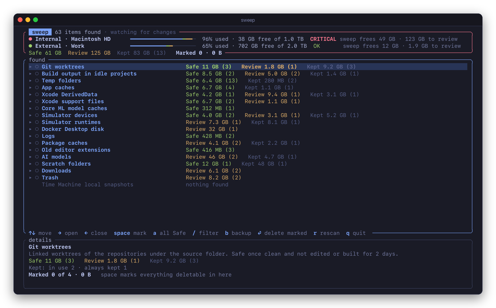
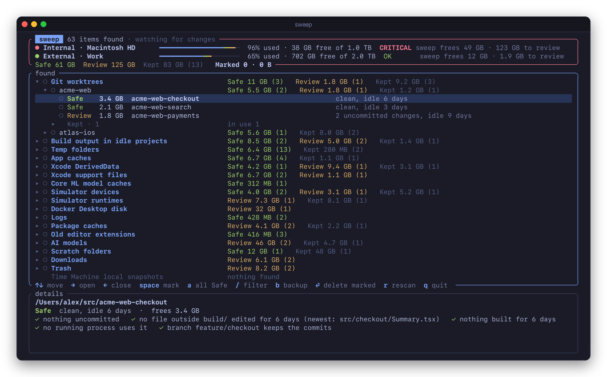
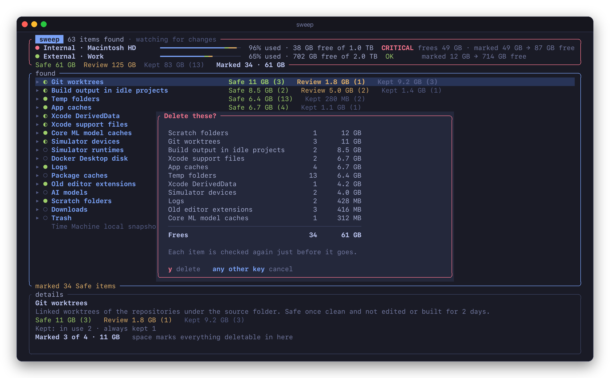
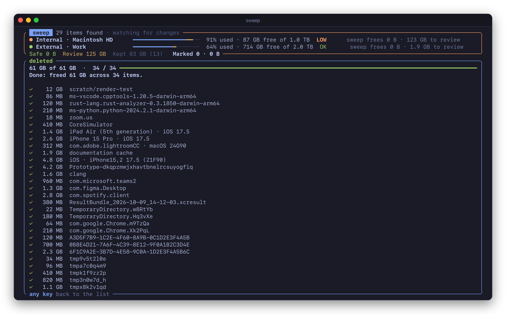

# sweep

Finds junk on your Mac, shows what deleting each item would really free, and deletes what you pick.



sweep doesn't guess. Each kind of junk has a rule, the rule checks every item it finds, and every item gets a badge:

- **Safe**: left over, and nothing of yours is lost. Caches, build output, temp folders: whatever needs them makes them again.
- **Review**: fine to delete, but it costs something. A download, a simulator's apps and data, what's in the Trash.
- **Kept**: something says no. It was written to recently, a running process uses it, its app is open, or it's on your keep list.

Every item says why, with the checks it passed and failed. Sizes are what deleting would actually free on APFS, not what `du` adds up. The top of the screen shows how full each physical disk is, and how much sweep could free on it.

## Install

sweep runs on macOS and builds with Rust 1.88 or later:

```sh
cargo install --git https://github.com/pdcgomes/sweep --locked
```

Then run `sweep`. It starts looking straight away and fills the list in as it finds things.

## What it looks for

| Kind | What | Badge |
|---|---|---|
| Git worktrees | Linked worktrees of the repositories under `~/src`, not edited or built for 2 days | Safe, or Review with uncommitted work |
| Build output | `target`, `.build`, `.next`, `.gradle` and the like, in projects nobody has edited for 14 days | Safe |
| | `node_modules`, `.venv` and `Pods` in those projects | Review |
| Temp folders | What known tools and tests leave in `$TMPDIR`, idle 2 days | Safe |
| App caches | `~/Library/Caches` and developer tools' caches, when the app isn't running and nothing was written for 7 days | Safe |
| Xcode DerivedData | Build products of projects that no longer exist | Safe |
| | Those of projects nothing has built for 30 days | Review |
| Xcode support files | Device symbols superseded by a newer copy or from devices not connected for 90 days, documentation, preview and test devices | Safe |
| | Archives | Review |
| Core ML model caches | Models compiled for another macOS build, or unused for 30 days | Safe |
| Simulators | Ones that can't boot any more | Safe |
| | The rest, which hold apps and data | Review |
| Simulator runtimes | Unused for 90 days | Review |
| Docker Desktop disk | Every image, container and volume, while Docker is stopped | Review |
| Logs | Files in `~/Library/Logs` not written for 7 days | Safe |
| Package caches | pip, uv, Homebrew, npm, Yarn, SwiftPM, Playwright and node-gyp | Review |
| Old editor extensions | Versions of extensions VS Code, VS Code Insiders or VSCodium no longer use | Safe |
| AI models | Ollama, Hugging Face, LM Studio, PyTorch hub, Chrome's on-device model | Review |
| Scratch folders | Top-level folders of the scratch folders you name in the settings, idle 7 days | Safe |
| Downloads | Files in `~/Downloads` over 500 MB, unchanged for 30 days | Review |
| Trash | The Trash, on every volume | Review |
| Time Machine snapshots | Local snapshots | Review |

Every number in that table is a setting.

## Every item says why



→ opens a kind and ← closes it. Kept items fold into one row per group, counted by reason. The details pane describes what's under the cursor: what a kind's rule does, or an item's path, badge, reason, size and checks.

## Deleting

Mark items with space, or every Safe item with `a`, then press ⏎. sweep lists what's marked and asks.



Each item is checked again just before it goes, and skipped if anything changed. Items go in parallel, and each deletion is written to `~/Library/Logs/sweep/<date>.log`. Some go through their own tools:

- Worktrees go with `git worktree remove`. Uncommitted work is committed to a `backup/worktree-<name>` branch first (`b` turns that off for one worktree), and a detached HEAD that no branch holds gets a branch too.
- Simulators and runtimes go with `simctl`, snapshots with `tmutil`, and the uv cache with `uv cache clean`. Ollama models go the way `ollama rm` does them: blobs another model shares stay.



`sweep --dry-run` goes through all of it, checks included, without deleting anything.

## Real sizes

APFS clones and snapshots share blocks, so `du` can overstate what deleting frees many times over: a worktree that `du` puts at 50 GB may free 8 GB. sweep reads each file's private size from the file system (`ATTR_CMNEXT_PRIVATESIZE`), the bytes no clone or snapshot shares. When `du` would say a lot more, the details say so.

## Leave it open

While it's open, sweep keeps the list up to date. FSEvents reports each file that changes, and only the item it belongs to is looked at again: new temp folders show up within a second, and deleted ones go. Verdicts that depend on time ("idle 2 days") or on what's running are checked again as those change. It all runs at utility priority, at around 1% of one core when nothing is happening. `r` scans again from scratch.

## Keys

| Key | |
|---|---|
| ↑ ↓ | move |
| → ← | open, close |
| space | mark or unmark |
| `a` | mark every Safe item |
| `/` | filter by name, path, reason or badge |
| `b` | save a worktree's uncommitted work first, or not |
| ⏎ | delete what's marked |
| `r` | scan again |
| `q` | quit |

## Without the interface

```sh
sweep scan                        # what it finds, the largest of each group
sweep scan --all --json           # everything, for scripts
sweep clean --safe --dry-run      # what --safe would delete
sweep clean --safe --kind temp --kind logs --yes
sweep clean --path ~/Downloads/old.iso --yes
```

`clean` deletes only with `--yes`. It takes every Safe item with `--safe`, Review items only when you name them with `--path`, and never a Kept item.

A weekly reminder: a launchd agent that scans and posts a notification with what it found. It never deletes anything.

```sh
sweep agent install --weekday 1 --hour 10   # Mondays at 10
sweep agent status
sweep agent uninstall
```

## Settings

sweep writes `~/.config/sweep/config.toml`, with comments, the first time it runs, and `sweep config` prints it. Every key is optional.

```toml
src_root = "~/src"   # where your repositories and projects live

# Never deleted: paths, or patterns where * matches within a name. An entry
# can say why, and the interface shows it.
keep = [
  "~/src/my-app/build/release",
  { path = "~/Library/Caches/Yarn", why = "offline installs need it" },
]

# More names your own tools leave in $TMPDIR.
temp_patterns = ["my-tests-*"]

[thresholds]
temp_days = 2
caches_days = 7
build_output_days = 14
# ...and the rest, listed in the file

# Folders whose top-level entries go once idle, except the ones kept.
[[scratch]]
path = "/Volumes/Scratch/tmp"
keep = ["fixtures"]
```

## Permissions

To read `~/Downloads` your terminal needs Files and Folders access, and to read the Trash it needs Full Disk Access, both in System Settings → Privacy & Security. Without them those two rows say what's missing, and everything else works. sweep doesn't look inside apps' sandbox containers, which would have macOS ask for permission app by app.

## License

[MIT](LICENSE)
